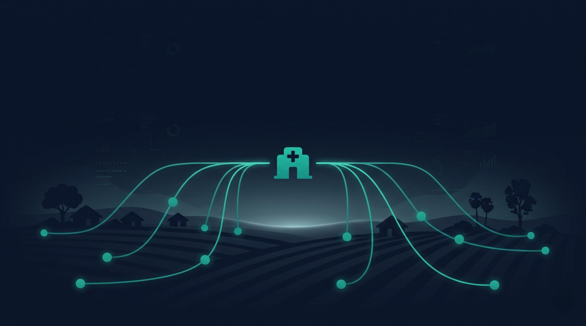
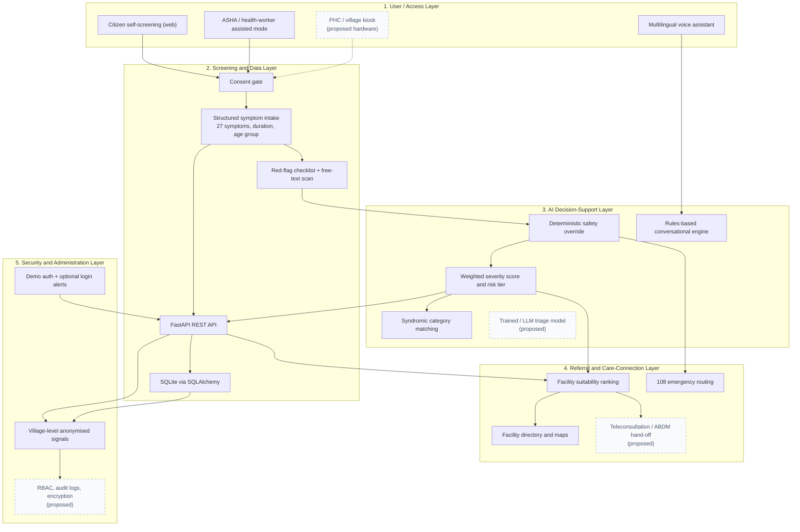
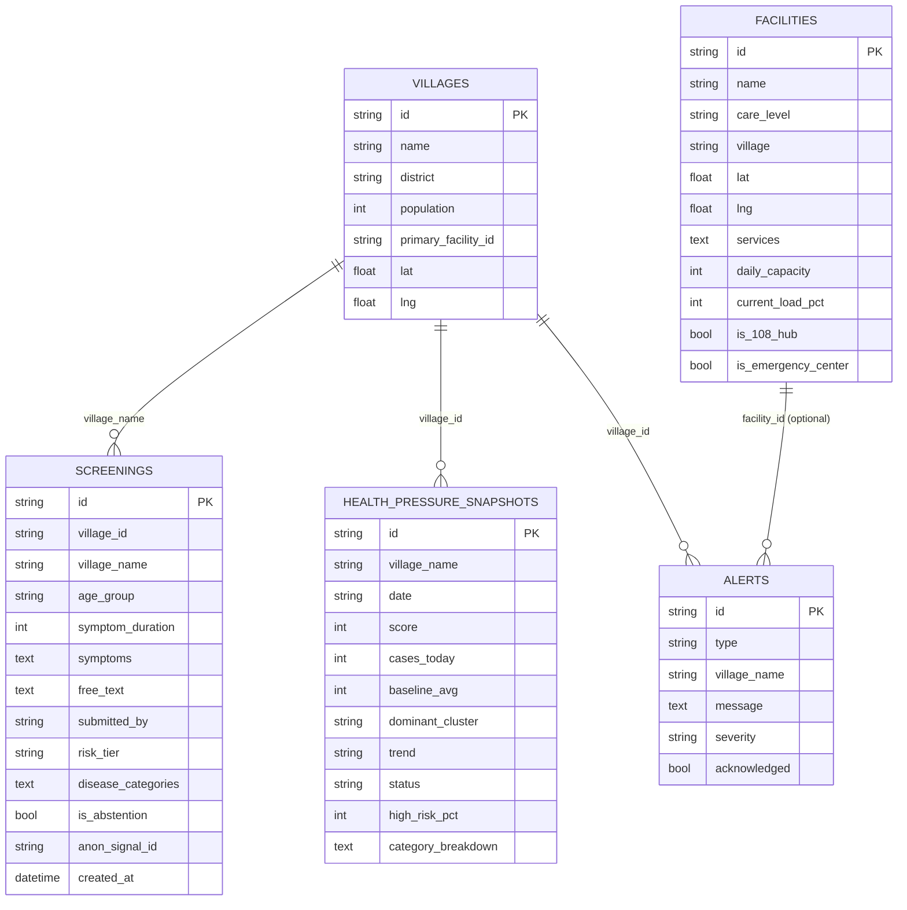
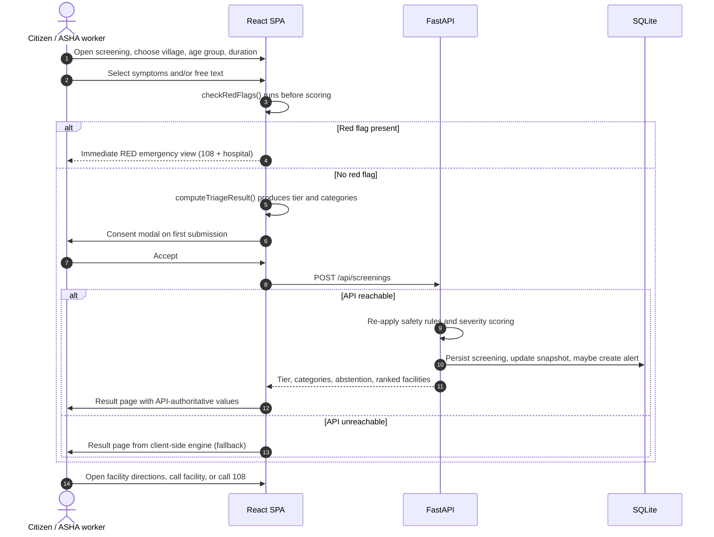

<p align="center">
  
</p>

<h1 align="center">SwasthyaNet</h1>

<p align="center">
  <strong>AI-Enabled Rural Healthcare Early-Warning &amp; Screening Network</strong>
</p>

<p align="center">
  <em>From screening individuals to protecting communities.</em>
</p>

<p align="center">
  
  
  
  
  
  
</p>

> [!IMPORTANT]
> **SwasthyaNet is a preliminary screening and decision-support prototype, not a diagnostic device.**
> It does not replace a qualified medical professional, a clinical examination or emergency services.
> In an emergency, call **108** (India's emergency ambulance helpline) immediately.

---

## Table of Contents

1. [Introduction](#1-introduction)
2. [Project Overview](#2-project-overview)
3. [Problem Statement](#3-problem-statement)
4. [Objectives](#4-objectives)
5. [Key Features](#5-key-features)
6. [System Architecture](#6-system-architecture)
7. [How SwasthyaNet Works](#7-how-swasthyanet-works)
8. [Technology Stack](#8-technology-stack)
9. [Project Directory Structure](#9-project-directory-structure)
10. [Installation and Local Setup](#10-installation-and-local-setup)
11. [Environment Variables and API Configuration](#11-environment-variables-and-api-configuration)
12. [Risk Classification and AI Decision Support](#12-risk-classification-and-ai-decision-support)
13. [Security, Privacy and Ethical Considerations](#13-security-privacy-and-ethical-considerations)
14. [Comparison with Existing Healthcare Ecosystems](#14-comparison-with-existing-healthcare-ecosystems)
15. [Project Advantages and Impact](#15-project-advantages-and-impact)
16. [Limitations](#16-limitations)
17. [Future Scope](#17-future-scope)
18. [Deployment on Vercel](#18-deployment-on-vercel)
19. [Research Paper](#19-research-paper)
20. [Project Information and Credits](#20-project-information-and-credits)
21. [Disclaimer](#21-disclaimer)

---

## 1. Introduction

**SwasthyaNet** is a web-based rural healthcare early-warning and screening platform. It is built around a simple but consequential question that many people in rural India face before they ever reach a doctor:

> *"Do these symptoms need attention — and how urgently?"*

Most digital-health products assume that the user already knows they need care. SwasthyaNet starts one step earlier. It collects a structured symptom description, applies a deterministic safety layer for emergency warning signs, estimates a preliminary triage priority, explains possible symptom clusters in plain language, and points the user toward a level of care that matches the estimated need.

The project addresses a well-documented gap in rural healthcare delivery: the distance between **symptom awareness** and **appropriate healthcare action**. Distance to facilities, shortage of specialists, out-of-pocket travel costs, low digital literacy, intermittent connectivity and delayed recognition of danger signs all stretch that gap. SwasthyaNet is designed to shorten it by making the first step — recognition and orientation — faster, clearer and less intimidating.

The platform has two complementary ambitions:

1. **Individual level** — help a citizen, or an ASHA/ANM worker acting on their behalf, understand how urgent a set of symptoms may be and where to go next.
2. **Community level** — convert individual, anonymised screenings into village-level "health pressure" signals so that primary facilities can see demand building up before patients arrive at their gates.

AI-assisted interaction is used here in a deliberately constrained way. The repository implements a **transparent, rule-based clinical decision-support engine** and a **rule-based multilingual conversational assistant** — not a generative model and not a trained diagnostic classifier. This was a conscious safety choice: emergency escalation should be deterministic, inspectable and independent of a model's phrasing. The accompanying research paper describes the broader AI-assisted vision; this README distinguishes what is implemented today from what remains proposed.

**Tagline:** *From screening individuals to protecting communities.*

---

## 2. Project Overview

SwasthyaNet is conceived as an **early-warning network**, not merely a symptom checker. Its design combines three functions that are usually delivered by separate systems:

| Function | What it means in SwasthyaNet |
| --- | --- |
| **Access** | Citizens screen themselves on a phone; health workers screen on a patient's behalf; the same interface is intended to run on a PHC or village kiosk tablet. |
| **Screening** | A structured intake of symptoms, duration, age group and optional free text, followed by deterministic red-flag checks and a four-level triage priority. |
| **Early warning** | Anonymised screenings are aggregated per village into a 0–100 Health Pressure score, with surge alerts and a facility-facing dashboard. |

The vision is to make preliminary screening **accessible, understandable and convenient** for rural and underserved communities:

- **Accessible** — no account is required for screening; the citizen flow is anonymous and mobile-first.
- **Understandable** — results are expressed as a triage priority with a recommended timeframe and care level, in everyday language, not as a disease label.
- **Convenient** — the platform answers "where should I go?" as well as "how urgent is this?", ranking facilities by care-level suitability, distance and current load.

The project does **not** attempt to reproduce a hospital consultation. It occupies the space before consultation: triage, orientation and referral, with a clear hand-off to a human clinician.

---

## 3. Problem Statement

Healthcare access is not determined only by the number of hospitals. It is determined by how long it takes a person to recognise that something is wrong, decide to seek care, and actually reach an appropriate provider.

SwasthyaNet targets the following constraints:

- **Limited access to healthcare facilities.** Primary facilities may be several kilometres away; specialist care may require a district-level journey.
- **Shortage of medical specialists.** PHCs and CHCs often operate with limited clinical staffing, so unnecessary visits and missed high-risk visits are both costly.
- **Delayed recognition of symptoms.** Danger signs such as breathlessness, chest pain, convulsions or bleeding in pregnancy are not always recognised as emergencies by patients or families.
- **Limited healthcare awareness.** Users may not know which level of facility — HWC, PHC, CHC or district hospital — is appropriate for their symptoms.
- **Distance and travel expenses.** A wasted trip imposes a real cost on a daily-wage household; fear of that cost can delay care.
- **Digital literacy and connectivity limitations.** Complex apps, mandatory logins and heavy pages exclude exactly the users who need them most.
- **Delayed professional consultation.** Symptoms may be managed at home until they escalate, at which point outcomes are worse and costs are higher.

The core problem is therefore the **gap between symptom awareness and appropriate healthcare action** — not a lack of medical information alone. A useful system must reduce friction at the first step, communicate urgency without pretending to diagnose, and preserve a pathway to a human professional when risk is elevated.

---

## 4. Objectives

The project's objectives, cross-referenced with the implementation status in this repository:

| # | Objective | Status in this repository |
| --- | --- | --- |
| 1 | Provide an accessible digital entry point for rural and underserved users | **Implemented** — responsive React SPA, no login required for screening |
| 2 | Collect structured symptoms and basic health information in a simple flow | **Implemented** — guided intake with 27 symptom options, duration, age group, gender, free text |
| 3 | Use AI-assisted reasoning or classification to prioritise urgency | **Implemented as a deterministic rule engine** — no trained ML model or LLM is used |
| 4 | Provide clear, non-diagnostic guidance and encourage professional evaluation | **Implemented** — tier-specific guidance, timeframe, care level and abstention handling |
| 5 | Support kiosk-based assisted access | **Partially implemented** — a health-worker assisted mode and kiosk-oriented UI exist; dedicated kiosk hardware/software does not |
| 6 | Enable a future referral and continuity layer | **Partially implemented** — facility ranking, directory, maps and 108 routing exist; teleconsultation and health-record integration do not |
| 7 | Design for multiple languages, offline/low-bandwidth operation and community screening | **Partially implemented** — multilingual voice UI, offline client-side fallback and village-level aggregation exist; offline-first kiosk sync and IVR do not |

Additional engineering objectives reflected in the code:

- Keep the emergency path **deterministic and auditable**, independent of any generative model.
- Minimise collected identity data in the screening flow.
- Keep the interface usable on low-end devices and slow connections (single-page bundle, lightweight assets, no heavy chart library).
- Make the system demonstrable end-to-end for review, academic evaluation and hackathon presentation.

---

## 5. Key Features

The features below are implemented in the current source tree. Each entry states what it does, how it is used, and its technical purpose. Research-paper proposals that are not in the code are listed separately in [Section 17](#17-future-scope).

### 5.1 Multi-channel symptom intake

**What it does:** Provides two screening channels over the same clinical engine — a citizen self-screening flow and an ASHA/health-worker assisted flow.

**How users interact:** From the home page, the user chooses *Check My Symptoms* (Channel 1) or *I'm a Health Worker, Helping a Patient* (Channel 2). The worker flow adds an optional field-notes box for observations such as measured temperature or ORS administration.

**Technical purpose:** Both channels render `SymptomIntakeWizard` with a `channel` prop (`citizen` | `worker`). The channel is preserved in `screeningDraft` and forwarded to the API as `submitted_by` (`asha` for worker submissions), allowing the triage stream to distinguish self-reported from assisted screenings. A third access route — PHC/village kiosk — is represented in the interface and documentation, but no separate kiosk application exists.

### 5.2 Consent gate before submission

**What it does:** Requires explicit consent before a screening is submitted, explaining that only village-level, anonymised information is retained.

**How users interact:** On first submission, a modal explains zero identity collection, village-level use of the signal and immediate anonymisation. The user may accept and continue, or cancel.

**Technical purpose:** `ConsentModal` gates `executeSubmission()` through `userLocationConsent` in `AppStateContext`. Consent is held in React state for the session; it is not persisted, versioned or recorded as an auditable consent event.

### 5.3 Structured symptom selection

**What it does:** Lets the user select from 27 clinically grouped symptom options across six categories, with search, category filters and an optional free-text description.

**How users interact:** Symptoms are toggled as cards; a search box filters by label or category; category pills narrow the list; the free-text area accepts unlisted complaints in everyday language. Duration, age group, gender and village are captured in the same form.

**Technical purpose:** `SYMPTOM_OPTIONS` in `src/data/mockData.ts` defines stable IDs (for example `sym_high_fever`), category, severity weight and the disease categories each symptom indicates. Stable IDs are what make the downstream rule engine deterministic and auditable, and what the backend stores as JSON arrays.

### 5.4 Deterministic emergency red-flag layer

**What it does:** Checks for emergency warning signs **before** any risk scoring, and forces a RED outcome when one is present.

**How users interact:** A dedicated red panel lists eight warning signs (for example chest pain with radiation, severe breathlessness at rest, altered consciousness/convulsions, bleeding in pregnancy, stiff neck with high fever, severe dehydration, self-harm risk). Selecting any of them immediately routes the result to the emergency screen.

**Technical purpose:** `checkRedFlags()` in `src/data/clinicalRules.ts` implements three layers: (1) direct red-flag IDs, (2) age-specific overrides for children under five and pregnant users, and (3) free-text keyword scanning. The FastAPI backend re-implements the same intent in `create_screening()` (`RED_FLAG_KEYWORDS`, age-specific checks), so the override is not solely a client-side behaviour.

### 5.5 Four-tier risk classification

**What it does:** Converts the symptom profile into a GREEN, YELLOW, ORANGE or RED triage priority with a recommended timeframe and care level.

**How users interact:** After submission, the result page announces the tier, the recommended timeframe (for example "within 24–48 hours"), the appropriate facility level and non-pharmacological self-care guidance.

**Technical purpose:** A weighted severity score combines symptom duration, symptom count, vulnerable age groups and selected high-severity symptoms; thresholds map the score to a tier and care level. Full formulas and thresholds are documented in [Section 12](#12-risk-classification-and-ai-decision-support). The tier is a **triage priority**, not a diagnosis.

### 5.6 Differential disease-category matching with confidence

**What it does:** Shows the top three syndromic categories that match the selected symptoms, each with a heuristic match percentage and the care level typically required.

**How users interact:** The result page lists categories such as *Acute Febrile Syndrome*, *Acute Respiratory Condition*, *Gastrointestinal / Diarrheal Illness*, *Chronic NCD (Hypertension / Diabetes Screening)* and others, with a short explanation and a `PHC`/`HWC`/`CHC` tag.

**Technical purpose:** `DISEASE_CATEGORIES` maps each category to a symptom signature. Matches are scored, normalised and bounded between 35% and 88% for display. The percentage is a **heuristic pattern-match score**, not a calibrated probability and not a validated likelihood of disease.

### 5.7 Clinical abstention

**What it does:** Refuses to over-interpret thin or non-specific input.

**How users interact:** If no symptoms and fewer than three characters of free text are supplied, the flow blocks submission. If symptoms do not match any category, the result explicitly states that the description is non-specific and recommends clinical examination.

**Technical purpose:** `computeTriageResult()` returns `isAbstention: true` with an explanation and a PHC/HWC recommendation instead of inventing a category. This mirrors the research paper's requirement that AI-assisted output express uncertainty rather than force an answer.

### 5.8 Facility suitability ranking

**What it does:** Recommends the three most appropriate facilities for the estimated care level, with distance, estimated travel time, current load, services and contact details.

**How users interact:** The result page shows a "best match" facility card with a suitability score, Google Maps directions and a tap-to-call link, followed by two secondary options.

**Technical purpose:** `rankFacilitiesForScreening()` scores facilities on four factors: care-level match (primary), travel time (secondary), service availability (tertiary) and current load (quaternary). Distance uses the Haversine great-circle formula; travel time is estimated at roughly two minutes per kilometre. The API performs an equivalent ranking server-side using the village's coordinates and returns the top three.

### 5.9 Emergency routing and persistent safety banner

**What it does:** Keeps emergency access one tap away at all times and gives RED results a dedicated, unmissable screen.

**How users interact:** A persistent red banner across the top of every page states the medical disclaimer and offers *Call 108*. The navigation bar also exposes 108. A RED result renders a full emergency view with *Call 108 Now*, a designated referral hospital and directions.

**Technical purpose:** `EmergencyBanner` and the `tel:108` links are plain anchors, so they work without JavaScript routing. `RedFlagEmergency` selects an emergency-capable facility from the facility list and deep-links to Google Maps directions and the hospital phone number.

### 5.10 Village Health Pressure early-warning dashboard

**What it does:** Aggregates screenings into a per-village pressure score, dominant syndrome cluster, trend, high-risk percentage and surge status, and presents it as a facility-facing console.

**How users interact:** The *Health Pressure* page shows the selected village's alert banner, pressure score, cases today versus baseline, dominant cluster, syndromic breakdown, a district village matrix, a live triage stream and a seven-day replay control.

**Technical purpose:** The backend stores `HealthPressureSnapshot` rows per village and increments them on each new screening (see [Section 12](#12-risk-classification-and-ai-decision-support)). The dashboard's displayed signals come from a seeded seven-day `SEEDED_TIMELAPSE_DAYS` dataset so the alert lifecycle can be demonstrated; the navbar alert count is fed by the live `/api/alerts` endpoint when the backend is reachable.

### 5.11 Anonymous community signal feedback

**What it does:** Confirms to the user that their screening contributed to a village-level signal without retaining identity.

**How users interact:** The result page ends with a confirmation panel showing the village cluster, aggregated category, tier and the generated anonymous signal ID, with a link to that village's radar.

**Technical purpose:** Each screening receives an `anon_signal_id` such as `anon_sig_a74f81`. The ID is a random token generated per submission, not a hash of personal data, and no name, phone number or address is collected in the screening flow.

### 5.12 Multilingual voice assistant

**What it does:** Offers a conversational alternative to the form: speech or typed input, spoken responses, quick-reply chips and emergency escalation.

**How users interact:** The user opens *Voice Assistant*, selects a language (or auto-detect), taps the microphone or types, and receives a reply that is also read aloud. Quick actions cover fever, cough/cold, pain, stomach problems, skin problems, medicine safety and finding a facility.

**Technical purpose:** `voiceAssistantEngine.ts` implements intent detection over keywords in Hindi, Marathi, English and code-mixed input, plus red-flag keyword detection, medicine-safety responses and facility guidance. Speech input uses the browser `SpeechRecognition`/`webkitSpeechRecognition` API and speech output uses `speechSynthesis`. The UI lists 13 Indian languages; authored reply content currently exists for **Hindi, Marathi and English**, with other selections falling back to English text while still using the selected locale's speech code.

### 5.13 Facility directory and spatial catchment view

**What it does:** Provides a searchable, filterable directory of HWC, PHC, CHC and district hospital facilities, with a map view and one-tap directions.

**How users interact:** The directory supports combined, list-only and map-only layouts; users filter by care level and switch between roadmap and satellite views. Selecting a facility reveals address, hours, load and contact actions.

**Technical purpose:** `FacilityList` and `FacilityMap` consume the facility list from context (API data when available, seeded data otherwise). If `VITE_GOOGLE_MAPS_API_KEY` is configured, the Google Maps JavaScript API renders markers; otherwise an embedded Google Maps iframe is used, with external directions links. Distances and travel times are computed client-side.

### 5.14 Demo authentication and login notifications

**What it does:** Provides login/registration, Google-style and phone-OTP-style entry points, plus an optional backend email notification on login.

**How users interact:** *Log In* / *Register* open a modal. The signed-in profile appears in the navbar with a sign-out option. Screening does not require an account.

**Technical purpose:** `AuthContext` creates a local profile and stores it in `localStorage` under `swasthyanet_auth_user`. **Authentication is simulated** — there is no password verification, token, session or server-side identity. On login, the client optionally calls `POST /api/auth/login-notify`, which writes an alert row and, if SMTP credentials are configured, emails the login event to the configured administrator address.

### 5.15 Demo presets, time-lapse replay and seeded scenarios

**What it does:** Makes the complete early-warning loop reviewable in under a minute.

**How users interact:** One-tap presets fill the form with febrile, diarrhoeal, cardiac red-flag, paediatric distress or mild self-care scenarios. The dashboard's seven-day replay animates how village pressure and alerts evolve, and the voice assistant includes scripted demo conversations.

**Technical purpose:** Presets and replay data live in `mockData.ts` and are rendered by `SymptomIntakeWizard` and `TimeLapseControl`. This is presentation and demonstration tooling; it does not represent real epidemiological history.

### 5.16 REST API and seeded persistence

**What it does:** Exposes the screening, facility, alert, triage and early-warning data over HTTP and persists submissions.

**How users interact:** Indirectly, through the web app; the API is also usable directly (for example `GET /api/health`).

**Technical purpose:** FastAPI with SQLAlchemy over SQLite. The database file `swasthyanet.db` is created and seeded automatically on first start with five villages, four facilities, five pressure snapshots, two alerts and four screenings. Endpoint reference is in [Section 6.3](#63-api-surface).

### 5.17 Client-side resilience fallback

**What it does:** Keeps the application usable when the API is unavailable — which is the normal case on a static Vercel deployment of this repository.

**How users interact:** The experience is unchanged; results are still produced and stored in React state.

**Technical purpose:** `addScreeningSubmission()` posts to the API and, on failure, constructs a submission locally using the client rule engine. `AppStateContext` seeds facilities, villages and triage data from `mockData.ts`, polls the API every 10 seconds when available, and silently retains seeds when it is not. The voice assistant similarly falls back from the API to `processRuralHealthConversation()`.

---

## 6. System Architecture

### 6.1 Conceptual five-layer model

The research paper proposes five logical layers. The table below maps each layer to what exists in this repository.

| Layer | Research-paper intent | Implemented in this repository | Status |
| --- | --- | --- | --- |
| **1. User / Access** | Responsive web interface plus community kiosk with touchscreen, guided prompts, optional voice and assisted operation | React SPA with citizen flow, ASHA/worker flow, multilingual voice assistant and kiosk-oriented UI copy | **Partially implemented** (web + assisted mode; no kiosk application or hardware integration) |
| **2. Screening and Data** | Structured symptom and risk-factor capture, minimised PII | Consent modal, structured intake, client/server validation, SQLAlchemy models and JSON symptom storage | **Implemented** |
| **3. AI Decision-Support** | AI-assisted risk/urgency classification, deterministic safety rules, uncertainty and explanation | Deterministic red-flag layer, weighted severity scoring, syndromic matching with heuristic confidence, abstention, rules-based conversational assistant | **Implemented as rules, not ML/LLM** |
| **4. Referral and Care-Connection** | Route higher-risk cases to facility, health worker, telemedicine or emergency pathway; integrate verified facility data | Facility suitability ranking, directory, maps, phone links, 108 routing | **Partially implemented** (no teleconsultation booking, no verified live facility feed, no ABDM exchange) |
| **5. Security and Administration** | Authentication, authorisation, consent, encryption, audit logs, minimal data, role separation | Village-level anonymisation, consent modal, demo client-side auth, login alert rows, optional SMTP notification | **Partially implemented** (no real auth/RBAC, encryption, audit trail or retention controls) |

### 6.2 Architecture diagram

The diagram distinguishes **implemented** components (solid) from **proposed** components (dashed).



### 6.3 API surface

The FastAPI service (`backend/main.py`) exposes the following routes:

| Method | Endpoint | Purpose |
| --- | --- | --- |
| `GET` | `/api/health` | Service health and UTC timestamp |
| `GET` | `/api/villages` | Seeded village profiles with coordinates and population |
| `POST` | `/api/screenings` | Accepts a screening, applies red-flag and severity rules, persists it, updates the village snapshot and returns risk tier, categories and ranked facilities |
| `GET` | `/api/facilities` | Facilities with distance, travel time, services, load, hours, suitability |
| `GET` | `/api/facilities/{id}` | Single facility detail |
| `GET` | `/api/health-pressure/district` | All village pressure snapshots with alert metadata |
| `GET` | `/api/health-pressure/{village_id_or_name}` | Single village pressure snapshot (falls back to Rampur) |
| `GET` | `/api/alerts` | Unacknowledged early-warning and login alerts |
| `GET` | `/api/triage-stream` | Most recent screenings with anonymised IDs |
| `POST` | `/api/voice-assistant/chat` | Multilingual rule-based conversational reply |
| `POST` | `/api/auth/login-notify` | Records a login alert and optionally sends an SMTP email |
| `POST` | `/api/auth/login` | Simulated login response with optional notification |

CORS is currently configured with `allow_origins=["*"]`. The API has no authentication, authorisation or rate limiting; see [Section 16](#16-limitations).

### 6.4 Data model



The schema stores symptom and category collections as JSON strings inside `Text` columns. There are no foreign-key constraints, migrations or retention policies.

---

## 7. How SwasthyaNet Works

### 7.1 End-to-end screening flow



### 7.2 Step-by-step user journey

| Stage | What happens | Status |
| --- | --- | --- |
| 1. Entry | User lands on the home page and chooses citizen screening, worker-assisted screening or the voice assistant. | Implemented |
| 2. Consent | A modal explains village-level anonymisation and asks for consent before the first submission. | Implemented (session-scoped) |
| 3. Symptom collection | Village, age group, duration, symptoms and optional free text are captured; workers can add field notes. | Implemented |
| 4. Symptom structuring | Selections are mapped to stable symptom IDs and syndromic signatures. | Implemented |
| 5. Safety assessment | Red-flag IDs, age-specific rules and free-text keywords are checked first. | Implemented |
| 6. Risk assessment | Weighted severity scoring assigns GREEN / YELLOW / ORANGE / RED and a care level. | Implemented (rule-based) |
| 7. Risk communication | The result page states the tier, timeframe and plain-language explanation, and flags abstention where relevant. | Implemented |
| 8. Guidance and referral | Non-pharmacological guidance plus three ranked facilities with directions and phone links. | Implemented |
| 9. Community signal | An anonymous signal ID is generated and the village snapshot is incremented. | Implemented (server when API available) |
| 10. Facility early warning | Surge status and alerts appear on the dashboard and navbar badge. | Implemented, demonstrated with seeded replay data |
| 11. Professional evaluation | The user is directed to a human clinician; the platform does not perform consultation. | Hand-off only |
| 12. Follow-up and record integration | Longitudinal follow-up, ABDM record exchange and teleconsultation continuity. | Conceptual / proposed |

### 7.3 Emergency path

When a red flag is detected, the normal result layout is bypassed entirely. The user sees a dedicated emergency screen with the clinical reason, a large **Call 108 Now** action, an alternative 104 helpline reference, the designated referral hospital with directions and phone number, and confirmation that the signal was dispatched to community telemetry. This ordering is intentional: the emergency action is presented before any explanatory content.

---

## 8. Technology Stack

All versions below are taken from `package.json`, source imports and configuration files in this repository.

### 8.1 Frontend

| Technology | Version / detail | Role |
| --- | --- | --- |
| React | `^19.0.0` | Component-based UI |
| React DOM | `^19.0.0` | Browser rendering |
| TypeScript | `~5.7.2` | Static typing across `src/` |
| Vite | `^6.1.0` | Dev server and production build |
| `@vitejs/plugin-react` | `^4.3.4` | React fast refresh and JSX transform |
| Tailwind CSS | `^4.0.0` via `@tailwindcss/vite` | Utility-first styling |
| lucide-react | `^1.16.0` | Icon set |
| clsx, tailwind-merge | `^2.1.1`, `^3.0.2` | Declared utilities; not currently imported in `src/` |
| Leaflet + `@types/leaflet` | `^1.9.4`, `^1.9.16` | Declared dependency and CSS link; no component currently imports Leaflet |

**Fonts:** Plus Jakarta Sans (headings), Inter (body) and IBM Plex Mono (numeric/technical values), loaded from Google Fonts in `index.html`.

**Routing:** There is no React Router. Navigation is a `PageView` union in `AppStateContext` rendered conditionally in `App.tsx`, with `vercel.json` providing an SPA rewrite for direct URL access.

**State management:** React Context (`AppStateContext`, `AuthContext`) with local component state. No Redux, Zustand or React Query.

**Charts:** Custom CSS progress bars and tables; no charting library.

### 8.2 Backend

| Technology | Detail | Role |
| --- | --- | --- |
| Python | 3.x (no pinned version in the repository) | API runtime |
| FastAPI | Imported in `backend/main.py` | HTTP API and request validation |
| Pydantic | Imported via FastAPI | Request/response schemas |
| SQLAlchemy | Imported in `backend/main.py` | ORM and schema definition |
| SQLite | `sqlite:///./swasthyanet.db` | Local persistence, auto-created and seeded |
| Uvicorn | Not pinned in the repository; standard ASGI runner | Local server |
| `smtplib` / `ssl` / `email` | Python standard library | Optional login notification email |

There is **no `requirements.txt` or `pyproject.toml`** in the repository; dependencies must be installed manually (see [Section 10](#10-installation-and-local-setup)).

### 8.3 AI / ML and conversational layer

| Capability | Implementation |
| --- | --- |
| Risk classification | Deterministic weighted rules in TypeScript and Python |
| Syndromic matching | Signature-based scoring with bounded heuristic confidence |
| Emergency detection | Keyword and rule matching (English, Hindi, Marathi and code-mixed terms) |
| Conversational assistant | Intent/keyword routing with authored responses |
| Speech input | Browser `SpeechRecognition` / `webkitSpeechRecognition` |
| Speech output | Browser `speechSynthesis` with locale-matched voices |
| External LLM / ML service | **None** — no OpenAI, Gemini, Anthropic, TensorFlow, PyTorch, scikit-learn or model files are present |

### 8.4 APIs and external services

| Service | Usage | Required? |
| --- | --- | --- |
| Google Maps JavaScript API | Interactive facility map with markers | Optional (`VITE_GOOGLE_MAPS_API_KEY`) |
| Google Maps embed (`maps.google.com/maps?...&output=embed`) | Fallback map when no key is configured | No key required |
| Google Maps directions/search URLs | Turn-by-turn hand-off | No key required |
| Google Fonts | Typography | Network access |
| `tel:` links (108, 104, facility numbers) | Emergency and facility calling | Device dependent |
| SMTP server | Login notification email | Optional |
| Browser Web Speech APIs | Voice input/output | Browser dependent |

### 8.5 Deployment and tooling

| Item | Detail |
| --- | --- |
| Vercel | `vercel.json` defines `npm run build`, output `dist`, SPA rewrite to `index.html` |
| GitHub Actions | `.github/workflows/deploy.yml` builds and deploys to GitHub Pages on push to `main`/`master` |
| npm | `package-lock.json` present; `npm ci` supported |
| TypeScript build | `tsc -b && vite build` |
| Dev proxy | Vite proxies `/api` to `http://localhost:8000` |

---

## 9. Project Directory Structure

```text
SwasthyaNet/
├── .agent/
│   └── skills/ui-ux-pro-max/          # AI-assistant skill data used during development (not runtime)
├── .agents/
│   └── skills/design-taste-frontend/  # AI-assistant skill instructions (not runtime)
├── .github/
│   └── workflows/deploy.yml           # GitHub Pages build and deploy workflow
├── backend/
│   └── main.py                        # FastAPI app, SQLAlchemy models, seed data, rule engine
├── public/
│   ├── images/                        # Served photography used across the UI
│   └── logos/                         # Logo variants and favicon
├── scripts/
│   ├── verify-backend.py              # Manual API smoke checks against localhost:8000
│   ├── verify-images-and-facilities.py# Asset reference and facility data audit
│   ├── verify-swasthyanet.mjs         # Standalone clinical-rule checks (JS)
│   └── verify-swasthyanet.ts          # Standalone clinical-rule checks (TS)
├── src/
│   ├── components/
│   │   ├── auth/AuthModal.tsx         # Login, registration, Google/OTP demo flows
│   │   ├── dashboard/                 # Health Pressure console, village matrix, triage stream, replay
│   │   ├── facility/                  # Facility list and Google Maps catchment view
│   │   ├── layout/                    # Emergency banner, navbar, footer
│   │   ├── result/                    # Tier result card, red-flag emergency view, signal confirmation
│   │   ├── screening/                 # Symptom intake wizard and consent modal
│   │   └── voice/                     # Voice assistant page component and floating trigger
│   ├── context/
│   │   ├── AppStateContext.tsx        # Page routing, draft state, API polling, fallbacks
│   │   └── AuthContext.tsx            # Simulated authentication persisted in localStorage
│   ├── data/
│   │   ├── clinicalRules.ts           # Red flags, disease signatures, severity scoring, facility ranking
│   │   └── mockData.ts                # Symptoms, villages, facilities, seven-day signals, seed screenings
│   ├── pages/                         # Home, screening, result, facilities, dashboard, voice, about
│   ├── services/
│   │   ├── api.ts                     # Typed fetch client for the FastAPI endpoints
│   │   └── voiceAssistantEngine.ts    # Languages, intent routing, red flags, speech managers
│   ├── types/index.ts                 # Shared TypeScript domain types
│   ├── App.tsx                        # Providers, page switch, signal toast
│   ├── index.css                      # Tailwind import, theme tokens, tier badge styles
│   └── main.tsx                       # React entry point
├── .env.example                       # Documented environment variables (no secrets)
├── .gitignore
├── index.html                         # HTML shell, fonts, Leaflet CSS, metadata
├── package.json
├── package-lock.json
├── skills-lock.json                   # Lock file for the development skill definitions
├── tsconfig.json
├── vercel.json                        # Vercel build and SPA rewrite configuration
└── vite.config.ts                     # React + Tailwind plugins, relative base, /api proxy
```

**Notes on the tree:**

- Root-level `.jpeg` and `.png` files duplicate assets that also exist under `public/`. Only `public/` paths are served by Vite; the root copies are not referenced at runtime.
- `.agent/` and `.agents/` contain assistant-skill material used while building the UI. They are not imported by the application.
- No `docs/` folder exists yet; see [Section 19](#19-research-paper) for where to add the research paper.

### 9.1 Important files explained

| File | Why it matters |
| --- | --- |
| `src/data/clinicalRules.ts` | The clinical core: red-flag definitions, syndromic signatures, severity scoring, tier thresholds, facility ranking |
| `src/data/mockData.ts` | All seeded content: 27 symptoms, 5 villages, 4 facilities, 7 replay days, sample screenings |
| `src/context/AppStateContext.tsx` | Application state, 10-second API polling, offline fallback, signal notification |
| `src/services/api.ts` | Single place where the frontend talks to the backend |
| `src/services/voiceAssistantEngine.ts` | Language definitions, red-flag vocabulary, intent routing, speech managers, demo scenarios |
| `backend/main.py` | Entire server: schema, seed data, rule engine, endpoints, optional SMTP notification |
| `vercel.json` | Production build command, output directory and SPA rewrite |
| `vite.config.ts` | Dev proxy that connects the frontend to `localhost:8000` |
| `.env.example` | Authoritative list of frontend variables and optional SMTP settings |

---

## 10. Installation and Local Setup

### 10.1 Prerequisites

| Requirement | Notes |
| --- | --- |
| Node.js 18+ (20 LTS recommended) | Required by Vite 6 |
| npm | `package-lock.json` is committed, so `npm ci` works |
| Python 3.9+ | For the optional FastAPI backend |
| pip | To install backend dependencies |
| Modern browser | Chrome or Edge recommended for Web Speech APIs; microphone permission needed for voice input |

### 10.2 Clone the repository

```bash
git clone https://github.com/Pranavgaikwad007/SwasthyaNet.git
cd SwasthyaNet
```

### 10.3 Frontend setup

```bash
npm ci
npm run dev
```

Open the URL printed by Vite (by default **http://localhost:5173**).

Production build check:

```bash
npm run build
npm run preview
```

`npm run build` runs `tsc -b` followed by `vite build`; output is written to `dist/`.

### 10.4 Optional backend setup

The frontend runs without the backend using its client-side rule engine and seeded data. To exercise the API:

```bash
cd backend
pip install fastapi uvicorn sqlalchemy pydantic
uvicorn main:app --reload --port 8000
```

The API is then available at **http://localhost:8000**, with interactive documentation at **http://localhost:8000/docs**. On first start, `swasthyanet.db` is created in the current working directory and seeded with demo data. The database file is git-ignored.

Start the frontend in a second terminal with `npm run dev`. The Vite dev server proxies `/api/*` to `http://localhost:8000`, so no frontend code changes are needed.

### 10.5 Verification scripts (optional)

The repository includes standalone verification utilities. They are not wired into `package.json` and no test runner is configured:

```bash
# API smoke checks (requires the backend running on port 8000)
python scripts/verify-backend.py

# Asset reference and facility data audit
python scripts/verify-images-and-facilities.py
```

`scripts/verify-swasthyanet.ts` and `scripts/verify-swasthyanet.mjs` exercise the clinical rules directly. They import from `src/data/*`, so they require a suitable TypeScript/JavaScript execution setup; no npm script is provided for them.

---

## 11. Environment Variables and API Configuration

### 11.1 Variables

| Variable | Layer | Required? | Purpose |
| --- | --- | --- | --- |
| `VITE_GOOGLE_MAPS_API_KEY` | Frontend (build time) | Optional | Loads the Google Maps JavaScript API for the interactive catchment map. Without it, an embedded Google Maps iframe is shown. |
| `VITE_GOOGLE_OAUTH_CLIENT_ID` | Frontend (build time) | Optional | Read by the auth modal. The current Google sign-in path is simulated and does not perform a real OAuth token exchange. |
| `NOTIFICATION_EMAIL` | Backend | Optional | Recipient for login notification emails. If unset, the backend falls back to the placeholder `admin@example.org` in `backend/main.py`, so delivery fails until a real address is configured. |
| `SMTP_HOST` | Backend | Optional | SMTP host, default `smtp.gmail.com`. |
| `SMTP_PORT` | Backend | Optional | SMTP port, default `587`; port `465` switches to SMTP over SSL. |
| `SMTP_USER` | Backend | Optional | SMTP username. If `SMTP_USER` and `SMTP_PASSWORD` are both empty, no email is sent. |
| `SMTP_PASSWORD` | Backend | Optional | SMTP/app password. Never commit this value. |
| `SMTP_FROM` | Backend | Optional | Sender address; defaults to `SMTP_USER` or `alerts@swasthyanet.org`. |

No API keys, tokens, passwords or personal addresses are included in this repository. `.env.example` ships with empty secret values and placeholder addresses only.

### 11.2 Where to configure

- **Frontend:** create a `.env` file in the repository root (it is git-ignored) and add the `VITE_*` variables. Vite exposes only variables prefixed with `VITE_` to client code, so these values are **visible in the browser bundle**. Restrict the Maps key by HTTP referrer in Google Cloud Console.
- **Backend:** `backend/main.py` reads configuration with `os.getenv()`. It does **not** import `python-dotenv`, so a `.env` file is not loaded automatically by the API. Set variables in your shell, process manager or hosting provider:

```bash
# PowerShell
$env:NOTIFICATION_EMAIL="admin@example.org"
$env:SMTP_USER="your-smtp-user"
$env:SMTP_PASSWORD="your-app-password"

# bash
export NOTIFICATION_EMAIL="admin@example.org"
export SMTP_USER="your-smtp-user"
export SMTP_PASSWORD="your-app-password"
```

- **Vercel:** add `VITE_*` variables in *Project → Settings → Environment Variables* before building, because Vite inlines them at build time.

### 11.3 Google Maps configuration

1. Create an API key in Google Cloud Console.
2. Enable **Maps JavaScript API**.
3. Restrict the key to your domains (for example `localhost:5173` and your Vercel domain).
4. Set `VITE_GOOGLE_MAPS_API_KEY` and rebuild/restart the dev server.

### 11.4 Email notification behaviour

`POST /api/auth/login-notify` always writes a `user_login` alert row. If SMTP credentials are present it also attempts to email the event; otherwise it logs to the server console and reports that delivery was skipped. Because login events can contain a name and email/phone, enable this only with appropriate consent and data-handling review.

### 11.5 API base URL

The frontend uses a relative base (`/api`) in `src/services/api.ts`. In development this is proxied by Vite; in production it resolves against the same origin. No API URL variable is currently defined, which is why the static Vercel deployment runs in fallback mode (see [Section 18](#18-deployment-on-vercel)).

---

## 12. Risk Classification and AI Decision Support

### 12.1 The four triage tiers

| Tier | Meaning | Guidance shown to the user | Care level |
| --- | --- | --- | --- |
| 🟢 **GREEN** | Low immediate concern | Self-care, hydration, rest, monitor 48–72 hours; visit HWC/ASHA if symptoms persist | HWC (Health & Wellness Centre / sub-centre) |
| 🟡 **YELLOW** | Professional consultation recommended | Visit a PHC or Ayushman Arogya Mandir within 24–48 hours | PHC |
| 🟠 **ORANGE** | Priority evaluation recommended | Same-day assessment at a 24x7 PHC or CHC; do not delay | CHC |
| 🔴 **RED** | Possible emergency requiring urgent professional attention | Call 108 immediately; go to a district hospital or first referral unit | District Hospital |

These tiers are **triage priorities, not diagnoses**. They describe how urgently a person should seek professional evaluation; they do not identify a disease.

### 12.2 What is actually implemented

There is **no trained machine-learning model and no generative AI call** in this repository. The "AI decision support" layer is implemented as two deterministic rule engines:

**A. Client engine — `src/data/clinicalRules.ts`**

1. **Red-flag override (first priority).** Any selected red-flag ID forces RED. Age-specific rules escalate children under five with rapid breathing or inability to feed, and pregnant users with bleeding or severe pelvic pain. Free-text keywords (unconsciousness, convulsion, seizure, suicide, blood vomiting, chest pain, bleeding) also force RED.
2. **Abstention.** No symptoms and fewer than three characters of free text produces an abstention with GREEN and a "see a health worker" message; the form itself blocks empty submission.
3. **Syndromic matching.** Each selected symptom contributes 20 points to every category whose signature contains it. The top three categories are shown with confidence bounded between 35% and 88%.
4. **Severity score.**
   - Duration: `>= 7 days` → +30, `>= 3 days` → +15, otherwise +5
   - Symptom count: `+8` per selected symptom
   - Vulnerable group (under 5, 60+, pregnant): `+18`
   - High-severity symptoms (high fever, wheezing, watery diarrhoea, jaundice, prolonged fever): `+25`
5. **Tier thresholds.** ORANGE at `>= 65`, or when a high-severity symptom has lasted `>= 4 days`; YELLOW at `>= 35`, or duration `>= 3 days`, or any high-severity symptom; otherwise GREEN.

**B. Server engine — `backend/main.py`**

The API re-evaluates every submission so that a client cannot simply assert a tier:

1. Red flags from the submitted list, age-specific rules, and free-text keywords force RED with a 99% "confidence" label and an emergency action string.
2. Otherwise severity is `10 × symptom count + 8 × duration + 15 (vulnerable group) + 20 (high-severity symptom)`.
3. ORANGE at `>= 65`, YELLOW at `>= 35`, otherwise GREEN.
4. Category scores are `25 × matched symptoms`; confidence is `min(88, max(40, score + 20))`.
5. The response also includes abstention state, emergency action and the top three ranked facilities.

> **Implementation note:** the client and server formulas are similar in intent but not numerically identical (for example, symptom weight `8` vs `10`, and different vulnerable-group bonuses). When the API is reachable, its response overwrites the client values in `AppStateContext`; when it is not, the client values are displayed. This is documented in [Section 16](#16-limitations) rather than presented as a single unified model.

### 12.3 Explainability

Every displayed output is traceable to code:

- The red-flag reason string comes from a fixed table of clinical reasons.
- The syndromic percentage is a bounded match score, not a probability.
- The severity inputs (duration, count, age group, high-severity symptoms) are all visible in the intake form.
- The abstention path is explicit rather than silently guessing.
- Facility ranking reasons are computed from care-level match, distance, services and load.

This is the practical meaning of "explainable risk assessment" in the current build: a reviewer can read the rules and reproduce the result.

### 12.4 Early-warning score mechanics

- Each village has a pressure score (0–100), a daily case count, a baseline average, a dominant cluster, a trend and a status.
- On `POST /api/screenings`, the village's `cases_today` increases by one. ORANGE/RED add 3 to the score, YELLOW adds 1.
- At a score of `>= 60`, the snapshot becomes `surge_warning`. If no unacknowledged alert exists for that village, a new `early_warning` alert is created with severity `HIGH` at `>= 75`, otherwise `ELEVATED`.
- Alert messages are templated: *"Unusual increase in similar reported symptoms in {village}. Increased screening capacity may be required."*

### 12.5 The conversational assistant

The voice assistant is also rule-based:

- **Language detection** uses script ranges and romanised keyword lists for Hindi and Marathi, defaulting to English.
- **Red-flag detection** scans multilingual and code-mixed phrases (breathlessness, chest pain, unconsciousness, paralysis, bleeding, neonatal fever, dehydration).
- **Intent routing** handles medicine-safety questions (it never prescribes), facility-finding questions, follow-up prompts (duration, accompanying symptoms, age) and general symptom guidance.
- **Response content** is authored for Hindi, Marathi and English; the language selector lists 13 Indian languages.
- **Speech** uses the browser's speech synthesis and recognition APIs; unsupported browsers fall back to typed input with a visible message.

---

## 13. Security, Privacy and Ethical Considerations

### 13.1 What the code does today

| Area | Implemented behaviour | Honest assessment |
| --- | --- | --- |
| Data minimisation in screening | No name, phone number, Aadhaar, email or precise address is requested in the screening flow | Genuine and verifiable in `SymptomIntakeWizard` and `ScreeningModel` |
| Consent | A modal explains village-level anonymisation before the first submission | Session-only; no consent record, version or withdrawal mechanism |
| Anonymisation | Random `anon_signal_id` per screening; village-level aggregation | Random token, not a cryptographic hash; no k-anonymity guarantee |
| Transport security | Depends on the host (Vercel/HTTPS in production) | No application-level encryption or certificate pinning |
| Storage security | SQLite file on the API host | Not encrypted at rest; no key management |
| Authentication | Simulated client-side profile in `localStorage` | **Not real authentication**; no password verification or server session |
| Authorisation | None on API endpoints | Dashboard is a UI view; the API does not enforce roles |
| API exposure | CORS allows all origins | Appropriate for a demo; not for production health data |
| Audit logging | Login events create alert rows | No general audit trail or access log |
| Login notifications | Optional SMTP email containing name and identifier | Requires consent and governance if enabled |

### 13.2 What must be added before handling real patient data

- Real authentication, role-based access control (citizen, ASHA, clinician, administrator) and session management.
- Encryption in transit and at rest, plus secrets management.
- A recorded, versioned consent artefact with withdrawal and deletion paths.
- Data retention limits and an auditable deletion workflow.
- API rate limiting, input hardening and CORS restriction to known origins.
- Audit logging for access to screening and alert data.
- A clinical governance process for reviewing red-flag rules and thresholds.
- Institutional ethics approval and data-governance permissions for any field study.

### 13.3 Responsible AI principles reflected in the design

1. **Safety before fluency.** Deterministic red flags take precedence over any conversational response.
2. **No diagnosis.** Outputs are triage priorities with an explicit non-diagnostic disclaimer.
3. **Uncertainty is expressed.** The abstention path says "we can't tell" instead of inventing a category.
4. **No prescribing.** Medicine questions receive safety guidance and a referral, never a dose.
5. **Human escalation is always available.** 108 and facility contacts are one tap away on every screen.
6. **Claims are bounded.** No accuracy, sensitivity or outcome statistics are claimed anywhere in the product or this README.

### 13.4 Known privacy nuance

The marketing copy in the UI states "zero identity data". That is accurate for the **screening flow**, but the optional demo login flow does collect a name and email/phone and can email a login event to an administrator. If you deploy this publicly, either disable the notification path or disclose it clearly.

---

## 14. Comparison with Existing Healthcare Ecosystems

SwasthyaNet is a prototype. The national platforms below operate at a scale, maturity and governance level that this project does not. The comparison is about **positioning**, not superiority.

| Capability | eSanjeevani | ABDM / ABHA | National NCD Screening | RBSK | SwasthyaNet |
| --- | --- | --- | --- | --- | --- |
| Primary purpose | Telemedicine | Digital health ecosystem and records | NCD screening | Child health screening | Early-warning screening and referral orientation |
| AI-assisted interaction | Not the core purpose | Not the core purpose | Limited / programme-specific | Programme-specific | Core design direction (implemented as rules) |
| Kiosk / assisted access | Possible assisted health-worker use | Not the primary access model | Field-worker apps | Mobile health teams | Assisted worker mode implemented; kiosk proposed |
| General symptom early warning | Secondary to consultation | No | Disease-focused | Child-condition focused | Yes |
| Referral orientation | Yes | Enables ecosystem connections | Yes | Yes | Yes |
| Rural-first UX | Supports rural telemedicine | National-scale | Field-worker focused | Community/child focused | Designed around rural accessibility |
| Interoperability role | Large public platform | National interoperability layer | Programme ecosystem | Programme ecosystem | Potential integration layer (not implemented) |

**Interpretation:**

- **eSanjeevani** solves consultation at scale. SwasthyaNet starts *before* the consultation decision — it helps a person work out whether and how urgently to seek care.
- **ABDM/ABHA** provides identity, registries, consent and record exchange. SwasthyaNet does not compete with it; a future version could use ABDM-compatible interfaces for consent and record hand-off.
- **National NCD screening** is a structured public-health programme for non-communicable diseases. SwasthyaNet is a general-purpose triage interaction that could host disease-specific modules.
- **RBSK** focuses on early identification and referral for children from birth to 18. SwasthyaNet targets a broader population and is a digital decision-support layer, not a government programme.

The defensible claim is narrow: SwasthyaNet combines **early-warning screening + assisted access + referral orientation** in one workflow. Whether that combination improves outcomes is an open research question, not a proven result.

---

## 15. Project Advantages and Impact

### 15.1 Potential advantages

- **Rural accessibility.** Anonymous, no-login screening that works on a basic smartphone browser.
- **Early identification of possible risk.** Deterministic red-flag checks surface emergencies that a user might otherwise dismiss.
- **Assisted screening.** ASHA/ANM workers can screen patients without smartphones and add field observations.
- **Reduced information gaps.** The result explains urgency, timeframe and the appropriate level of care in plain language.
- **Referral orientation.** Facility ranking answers "where should I go?" with distance, services, load and contact details.
- **Community-level situational awareness.** Village pressure scores and surge alerts give facilities advance notice of demand.
- **Transparency.** Every rule is readable; there is no opaque model to audit around.
- **Low-bandwidth design.** No heavy chart or map library is required; maps degrade to an embed; the UI is a single Vite bundle.

### 15.2 Potential impact

If validated, the approach could contribute to:

- shorter time from symptom onset to appropriate care;
- fewer unnecessary journeys to the wrong level of facility;
- better preparedness at PHCs/CHCs during local surges;
- improved health awareness through plain-language guidance;
- a reusable digital triage layer for community health programmes.

### 15.3 What is *not* claimed

This project does **not** claim:

- clinical accuracy, sensitivity, specificity or safety performance;
- reduced mortality or morbidity;
- proven cost savings or time savings;
- validation against a representative clinical dataset;
- deployment at scale or use by any government programme;
- that AI outputs are equivalent to a medical examination.

These outcomes require prospective field evaluation, ethics approval and clinical review. The research paper explicitly makes the same point.

---

## 16. Limitations

### 16.1 Clinical and methodological

- **No clinical validation.** No sensitivity, specificity, calibration or outcome data exists. The rules are heuristics, not a validated triage instrument.
- **No physical examination or vitals.** The system sees only self-reported symptoms, duration, age group and optional text. It cannot measure temperature, blood pressure, oxygen saturation or glucose.
- **Self-report bias.** Symptoms may be under-reported, misdescribed or entered by a third party.
- **Heuristic confidence.** The displayed percentage is a bounded match score, not a probability.
- **Two scoring engines.** Client and server formulas differ slightly, so the same input can produce marginally different tiers depending on whether the API is reachable.
- **Rule coverage.** The symptom list has 27 options and the red-flag list has 8 entries; rare or atypical presentations may not be represented.

### 16.2 Data and demo content

- **Seeded demo data.** Villages, facilities, bed load, phone numbers, coordinates and pressure scores are illustrative data for Sitapur district, Uttar Pradesh. They are not a verified live facility directory.
- **Estimated travel.** Distance is straight-line Haversine, and travel time assumes roughly 30 km/h; neither reflects real roads, transport availability or seasonal conditions.
- **Simulated surveillance.** The dashboard's seven-day replay is seeded demonstration data. Live API signals are fetched into context but the dashboard renders the replay state.
- **Duplicate assets.** Root-level images duplicate `public/` assets and are unused at runtime.

### 16.3 Security and privacy

- No real authentication, sessions or role-based authorisation.
- API endpoints are unauthenticated and CORS is open to all origins.
- SQLite is unencrypted; no secrets management or key rotation.
- Consent is session-only and not recorded.
- No retention, export or deletion workflow.
- The optional login notification can transmit identifiers by email.
- No rate limiting, abuse protection or audit logging.

### 16.4 Deployment and runtime

- **The FastAPI backend is not part of the Vercel deployment.** `vercel.json` rewrites every path to `index.html`, so `/api/*` requests return the SPA rather than JSON. On a static deployment the app therefore runs on its client-side fallback: client rule engine plus seeded data, with no persistence across users or devices.
- The backend has no `requirements.txt` or pinned Python versions.
- There is no automated test suite or CI test job; only standalone verification scripts.
- The backend file contains a second, shadowed definition of `POST /api/voice-assistant/chat`; FastAPI serves the first registered route, so the later definition is unreachable.
- Voice features depend on browser support. Chrome/Edge provide speech recognition; Firefox support is limited and Safari behaviour varies. Microphone permission is required.
- The 13-language selector is broader than the authored content: replies exist for Hindi, Marathi and English, with other languages falling back to English text.
- No service worker, offline cache, IVR, SMS or kiosk sync exists.

### 16.5 Product scope

- No appointment booking, teleconsultation, prescription or e-record integration.
- No clinician review queue with acknowledgement actions in the UI (alerts are stored with an `acknowledged` flag but no endpoint or screen updates it).
- No ABDM/ABHA integration, despite the roadmap.
- The kiosk concept is represented in the UI and research paper, not in dedicated hardware or kiosk-mode software.

---

## 17. Future Scope

The following items come from the research paper and the project roadmap. Unless explicitly marked otherwise, they are **not implemented** in this repository.

| Enhancement | Description | Current status |
| --- | --- | --- |
| Multilingual voice-based screening | Full authored content and ASR/TTS tuning across all 13 listed languages, including dialect handling | Partial — UI and speech layer exist; content is Hindi/Marathi/English |
| IVR for feature phones | Toll-free voice screening with local-dialect ASR and spoken advice on 2G phones | Proposed (described on the About page) |
| Offline-first kiosk operation | Local caching, queued sync and kiosk-mode shell for low-connectivity sites | Proposed |
| IoT medical devices | BP monitor, pulse oximeter, thermometer and glucometer integration for objective vitals | Proposed |
| ABDM-compatible integration | ABHA identity, consent artefacts, health-record exchange and facility registry alignment | Proposed |
| Community health-worker dashboards | Caseload, follow-up lists and referral tracking for ASHA/ANM users | Proposed; current worker mode is intake-only |
| Explainable risk assessment | Rule traces, contributing-factor display and calibration reporting | Partial — rules are transparent; no factor-level explanation UI or calibration |
| Longitudinal health monitoring | Repeat screenings, trend tracking and follow-up reminders | Proposed |
| Disease-specific modules | Dedicated NCD, maternal health and child health pathways | Proposed; general categories exist |
| Privacy-preserving analytics | Federated or differentially private aggregation | Proposed |
| Clinical validation study | Prospective evaluation against clinician triage with sensitivity/specificity reporting | Proposed |
| Model monitoring and human-in-the-loop review | Drift monitoring, unsafe-output review and rule governance | Proposed |

---

## 18. Deployment on Vercel

The repository is already configured for a static Vite deployment. No configuration changes are required.

### 18.1 Existing configuration

`vercel.json`:

```json
{
  "buildCommand": "npm run build",
  "outputDirectory": "dist",
  "rewrites": [{ "source": "/(.*)", "destination": "/index.html" }]
}
```

`vite.config.ts` sets `base: './'`, which keeps asset URLs relative and works on both Vercel and GitHub Pages.

### 18.2 Steps

1. Push the repository to GitHub (the default branch is `main`).
2. Sign in to [Vercel](https://vercel.com/) and choose **Add New → Project**.
3. Import `Pranavgaikwad007/SwasthyaNet`.
4. Confirm the detected settings:
   - **Framework preset:** Vite
   - **Build command:** `npm run build`
   - **Output directory:** `dist`
   - **Install command:** `npm ci` (or the default `npm install`)
   - **Root directory:** repository root
5. (Optional) Add environment variables under **Settings → Environment Variables**:
   - `VITE_GOOGLE_MAPS_API_KEY` — enables the interactive Google map
   - `VITE_GOOGLE_OAUTH_CLIENT_ID` — read by the auth modal (Google sign-in remains simulated)
6. Click **Deploy** and wait for the build to finish.
7. Verify the deployment:
   - Home page loads and navigation works across all pages.
   - A screening completes and shows a tier, categories and facilities.
   - The emergency preset shows the RED view and the 108 action.
   - The facility page renders either the Google map or the embedded map.
   - The dashboard replay and village matrix render.
   - Voice input works in Chrome/Edge with microphone permission.
   - Direct URL loads fall back to the SPA rather than a 404.

### 18.3 Important deployment caveat

The Vercel configuration deploys **only the frontend**. Because all routes are rewritten to `index.html`, requests to `/api/*` do not reach a backend. The application detects this and falls back to the client-side rule engine and seeded data, so the demo works but does not persist screenings or share alerts between users.

To enable live API behaviour you would need to host `backend/main.py` separately (for example on a Python-capable platform), add a `VITE_`-based API base URL or a proxy rewrite, and restrict CORS. That is a future deployment decision; this README does not change any configuration.

### 18.4 Alternative: GitHub Pages

`.github/workflows/deploy.yml` builds the app and deploys `dist/` to GitHub Pages on pushes to `main` or `master`. This is an alternative static host; the same API caveat applies.

---

## 19. Research Paper

The accompanying research paper is titled:

> **SwasthyaNet: An AI-Enabled Rural Healthcare Early-Warning and Screening Network** — *A Digital Healthcare Architecture for Preventive Screening, AI-Assisted Risk Assessment, Kiosk Access and Referral Support.*

It covers:

1. **Introduction and problem statement** — why the gap between symptom awareness and appropriate care matters in rural India.
2. **Related work** — eSanjeevani, ABDM/ABHA, population-based NCD screening, RBSK and commercial symptom checkers.
3. **Proposed architecture** — the five logical layers: user/access, screening and data, AI decision support, referral and care connection, and security/administration.
4. **Technology architecture** — functional stack and a recommended production stack, explicitly separated from verified implementation details.
5. **Methodology** — requirement analysis, data model, safety design, AI layer, interface/kiosk, referral mapping and evaluation.
6. **Risk classification** — the four-tier Green/Yellow/Orange/Red model as triage priority, not diagnosis.
7. **Security and privacy** — privacy-by-design, consent, encryption, role separation, audit logs and responsible AI.
8. **Evaluation plan** — technical, AI, usability and system-level metrics, with an explicit statement that no clinical accuracy is claimed.
9. **Comparison with existing ecosystems** — positioning rather than superiority.
10. **Limitations and future scope** — validation requirements, kiosk/offline work, ABDM integration, IoT devices and longitudinal monitoring.

### Where to add the PDF

The paper is **not currently stored in this repository**, so no link is provided (a broken or invented link would be worse than none). To publish it:

1. Create a `docs/` folder in the repository root.
2. Add the PDF as `docs/SwasthyaNet_Research_Paper.pdf`.
3. Replace this paragraph with: `[Read the SwasthyaNet Research Paper](docs/SwasthyaNet_Research_Paper.pdf)`.

Until then, this section is a labelled placeholder rather than a fake reference.

---

## 20. Project Information and Credits

| Item | Detail |
| --- | --- |
| **Project** | SwasthyaNet — AI-Enabled Rural Healthcare Early-Warning & Screening Network |
| **Problem statement** | PSE13 — Health Screening Assistant |
| **Repository** | [github.com/Pranavgaikwad007/SwasthyaNet](https://github.com/Pranavgaikwad007/SwasthyaNet) |
| **Reference deployment** | [swasthyanet-xi.vercel.app](https://swasthyanet-xi.vercel.app/) — previous/reference deployment only; the current repository state is not claimed to be live there |
| **Primary stack** | React 19 + TypeScript + Vite + Tailwind CSS 4; FastAPI + SQLAlchemy + SQLite |
| **License** | No license file is present in the repository. Add one before distributing or accepting external contributions. |

### Acknowledgements

- **Project owner and maintainer:** Pranav Gaikwad (repository owner).
- **Team SwasthyaNet:** the accompanying research paper references Team SwasthyaNet and a Smart India Hackathon 2025 recognition at K.K. Wagh Institute of Engineering Education and Research. Individual contributor names are not listed here because they could not be verified from the repository history.
- **Public healthcare references:** the project builds on the public documentation of eSanjeevani, ABDM/ABHA, the National NCD Screening Programme, RBSK and Ayushman Arogya Mandir. These systems are referenced for context and are not affiliated with this project.

If you are a contributor and would like to be credited, add your name and role in a pull request.

---

## 21. Disclaimer

> [!WARNING]
> **SwasthyaNet is an AI-assisted preliminary screening and decision-support project. It is not intended to replace qualified medical professionals, clinical examinations or emergency medical services. Its outputs should not be considered definitive medical diagnoses. Users should seek appropriate professional medical attention.**

Additional clarifications:

- Risk tiers describe **urgency of evaluation**, not the presence or absence of disease.
- Confidence percentages are heuristic symptom-match scores, not probabilities.
- The facility list, bed load, phone numbers and surveillance data in this repository are illustrative demo data and must not be used to plan real care.
- Emergency symptoms require an immediate call to **108** or attendance at the nearest emergency department, regardless of what the application displays.
- Any clinical, field or research use requires ethics approval, clinical governance and prospective validation.

---

<p align="center">
  <sub>Built for rural early-warning screening · SwasthyaNet · PSE13</sub>
</p>
